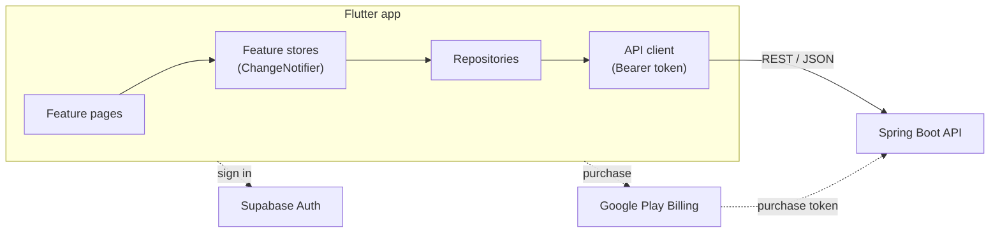

<h1 align="center">fonlio · Mobile App</h1>

<p align="center">
  The Flutter app for candidates on <a href="https://www.fonlio.online"><b>fonlio</b></a>, a gamified reputation and hyperlocal talent marketplace for Gen Z in Vietnam.
</p>

<p align="center">
  
  
  
  
  
</p>

<p align="center">
  <a href="https://www.fonlio.online"><b>🌐 Live product</b></a> ·
  <a href="https://github.com/proj-nextplease/backend">Backend API</a> ·
  <a href="https://github.com/proj-nextplease/frontend">Web app</a>
</p>

---

## Overview

fonlio helps students build a **verified reputation** through jobs, quests and credentials, and helps businesses find and hire local talent. The platform is **live with 100+ users**.

This app gives **candidates** the full fonlio experience on their phone. It shares one [backend API](https://github.com/proj-nextplease/backend) with the web app and has no backend of its own. Like the web app, it is a thin client: it never calculates wallet balance, locked funds, fees, Reputation Score or verification status. It only renders what the API returns.

<!-- Tip: add 3–4 phone screenshots side by side here, e.g.
<p align="center">
  
  
  
</p>
-->

---

## Features

| Module | What candidates can do |
|---|---|
| **Jobs & quests** | Browse and search opportunities, filter, check eligibility, save, apply |
| **Applications** | Track every application through its status timeline |
| **Profile & portfolio** | Edit the profile and experience, view the public profile and portfolio, receive ratings |
| **Credentials** | Submit evidence (photos or links) for AI-assisted verification |
| **Companies** | Browse the company directory and follow companies |
| **Discussions** | Read and write posts in the community forum |
| **Wallet** | Top up NP, view transaction history, upgrade to Premium |
| **Gamification** | Quest board, EXP and Reputation, reward feedback |
| **Notifications** | In-app notification centre with deep links to the related screen |
| **Onboarding & legal** | First-run onboarding and a Terms & Privacy consent gate |

---

## Highlights

### 🧱 Feature-first architecture
Each feature in `lib/features/` owns its UI, state and data access (pages, store and repository), so features can grow without touching each other. Shared building blocks (API client, theme, config, widgets) live in `lib/core/`.

### 🔄 State management without an extra framework
State uses Flutter's built-in **`ChangeNotifier`**: 9 per-feature stores consumed through `ListenableBuilder`. Data access stays out of widgets, and the app avoids a third-party state library.

### 🔐 Authentication
- **Supabase Auth** with email and social sign-in (**Google, Facebook, GitHub**) through a deep-link OAuth callback
- Session stored in **`flutter_secure_storage`**, with the access token attached to every API request by a shared API client

### 💳 Platform-aware payments
- **Android → Google Play Billing**, as Google Play requires for digital goods. The app never adds NP to the wallet itself: it sends the purchase token to the backend, which verifies it with Google before crediting. The app listens to the purchase stream for its whole lifetime, so a purchase that completes after the screen is closed (delayed payment, lost connection, app killed) is still delivered on the next launch.
- **Other platforms → PayOS VietQR**, with a **save-QR-to-gallery** option so users can pay from their banking app, plus live status checks when the app returns to the foreground.

### 🎨 Design system
A shared **design-token theme layer** (colour, typography, spacing) gives every screen a consistent look on Android and iOS. Custom fonts, mascots and icon sets are included, along with **Vietnamese and English localization** through `flutter_localizations`.

### 🌐 Works on every device setup
The API base URL resolves per platform and can be overridden at build time, so the same code reaches the backend from the iOS simulator, the Android emulator and physical devices.

### ✅ Tested
Widget and unit tests cover key flows, including the consent gate, onboarding gate, quest board, notification banner and date handling.

---

## Tech stack

| Area | Technology |
|---|---|
| Framework | Flutter, Dart 3 |
| State | `ChangeNotifier` + `ListenableBuilder` |
| Networking | `http` with a shared API client |
| Auth | `supabase_flutter`, `flutter_secure_storage` |
| Payments | `in_app_purchase` (Google Play Billing), PayOS VietQR (`qr_flutter`, `gal`) |
| Media | `image_picker`, `flutter_svg` |
| Storage | `shared_preferences` |
| i18n | `flutter_localizations` (vi, en) |
| Quality | `flutter_lints`, `flutter_test` |

---

## Architecture



---

## Getting started

### Prerequisites
- Flutter SDK (Dart 3.x)
- Android Studio (Android emulator) or Xcode (iOS simulator)

### 1. Configure
Copy the template and fill in your Supabase values:
```bash
cp env.example.json env.json
```

| Key | Description |
|---|---|
| `SUPABASE_URL` | Supabase project URL |
| `SUPABASE_ANON_KEY` | Supabase anon (public) key |
| `API_BASE_URL` | Optional: leave empty to use the default API |

`env.json` is git-ignored.

### 2. Run
```bash
flutter pub get
flutter run --dart-define-from-file=env.json
```

### Running against a local backend
`localhost` on an emulator does **not** point to your computer:

| Target | API URL to use |
|---|---|
| iOS simulator | `http://localhost:8080` |
| Android emulator | `http://10.0.2.2:8080` |
| Physical device | Your computer's LAN IP, e.g. `http://192.168.1.12:8080` |

```bash
flutter run --dart-define-from-file=env.json --dart-define=API_BASE_URL=http://10.0.2.2:8080
```

See `lib/core/config.dart` for details, including the cleartext-HTTP exceptions needed for local development.

### Run tests
```bash
flutter test
```

---

## Project structure

```text
lib/
├── main.dart, app.dart   App entry, routing, localization
├── core/                 API client, config & env, theme and design tokens, shared widgets
└── features/
    ├── auth/             Sign-in, registration, social login
    ├── onboarding/       Splash and first-run onboarding
    ├── home/             Home feed
    ├── jobs/             Opportunities, search, filters, saved and applied items
    ├── profile/          Profile, portfolio, applications, notifications, quest board
    ├── credentials/      Credential submission and evidence picker
    ├── companies/        Company directory and follows
    ├── discussions/      Community forum
    ├── wallet/           NP wallet, Google Play Billing, PayOS
    ├── legal/            Terms & Privacy consent
    └── shell/            Bottom-navigation shell
```

---

<p align="center">
  Built and maintained by <a href="https://github.com/PhatNT284"><b>Nghê Tài Phát</b></a> ·
  <a href="https://www.linkedin.com/in/ngtphat">LinkedIn</a>
</p>
